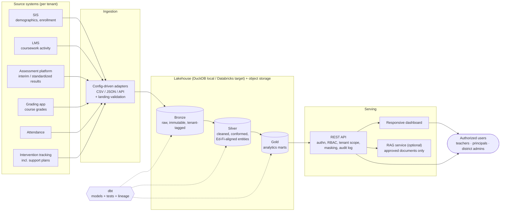
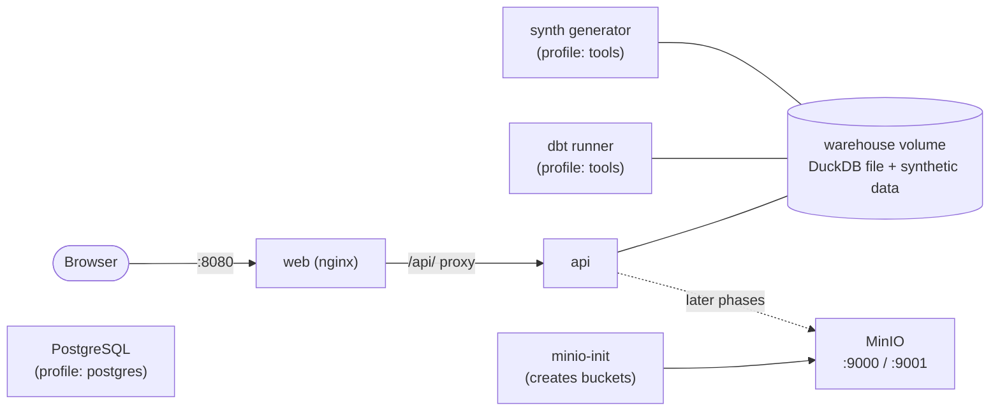

# EduPulse AI — Architecture

> **Status:** target architecture plus a Phase 1 build-status table. Only the pieces marked
> **Built** exist today; everything else is **Planned** and described here so the foundation is
> shaped correctly. EduPulse implements *technical controls consistent with FERPA-aligned
> practices*. It is not FERPA-certified and nothing here is a statement of legal compliance.

## 1. System context

## 2. Layers

| Layer | Contents | Rules |
|-------|----------|-------|
| **Bronze** | Source extracts exactly as received, plus load metadata (`tenant_id`, source system, batch id, load time, file checksum, `synthetic_marker` when applicable). | Append-only, never edited. Replayable. Highest sensitivity: access limited to pipeline roles. |
| **Silver** | Typed, deduplicated, conformed entities (student, school, enrollment, assessment result, attendance event, grade, LMS event, intervention). Ed-Fi-aligned names. | Every table carries `tenant_id`. Failed records are quarantined with a reason, not silently dropped. dbt tests gate promotion. |
| **Gold** | Analytics marts: proficiency gaps, assessment completion, longitudinal growth, intervention priority lists. | Aggregates by default; student-level rows exposed only through role-checked API paths. Small-cell suppression for equity cuts. |

## 3. Cross-cutting design decisions

Each has a short ADR in [`docs/adr/`](adr/):

- **Tenancy** ([ADR-0002](adr/0002-tenancy-model.md)): shared tables with a mandatory `tenant_id`
  column, enforced in the API (and by PostgreSQL row-level security in the serving store);
  tenant-prefixed object-storage paths.
- **Canonical model** ([ADR-0001](adr/0001-canonical-data-model.md)): Ed-Fi-*aligned* naming and
  descriptors in Silver, not a full Ed-Fi ODS.
- **Local runtime** ([ADR-0003](adr/0003-local-runtime.md)): DuckDB + MinIO by default, PostgreSQL
  optional, Databricks as the production-shaped target behind dbt adapters.

### Security and privacy controls (target)

| Control | Approach | Phase 1 |
|---------|----------|---------|
| Least-privilege RBAC | Roles: teacher (own classes), principal (own school), district admin (tenant), pipeline/service. Deny by default. | Planned |
| Field-level sensitivity | Every column classified (public / internal / confidential / restricted); masking and hashing options per class. | Sensitive fields present in synthetic data to exercise this; classification planned |
| PII minimization | Gold exposes the minimum fields; pseudonymous keys for analytics. | Planned |
| Audit logging | Append-only record of who accessed which tenant/student/field and why. | Planned |
| Encryption | TLS in transit; at-rest encryption via storage/warehouse features where supported. | Documented only |
| Retention | Per-tenant retention policy with scheduled purge jobs. | Planned |
| Synthetic-only repository | Generator + validator + CI guard; PII-pattern scan; `.env`/`data/` blocked by git ignore and pre-commit. | **Built** |
| AI guardrails | RAG limited to approved institutional documents; no student-level indexing; outputs advisory, with citations. | Planned |

## 4. Build status (Phase 1 + Phase 2)

| Component | Status | Where |
|-----------|--------|-------|
| Monorepo, packaging, lint, tests, CI | **Built** | `pyproject.toml`, `.github/workflows/ci.yml`, `tests/` |
| Synthetic data generator + validator | **Built** | `ingestion/synthetic/` |
| Health/version API stub | **Built** (placeholder, not the real API) | `api/health.py` |
| Dashboard scaffold | **Built** (static page) | `web/public/` |
| Compose stack, Dockerfiles | **Written; not run** (no Docker daemon in the build environment — see evidence manifest) | `docker-compose.yml`, `infra/docker/` |
| dbt project skeleton | **Written; not run** (dbt not installable in the build environment) | `dbt/` |
| Multi-source ingestion framework: 6 connectors, YAML mapping, Bronze (immutable, tenant-partitioned), dead letter, retry/backoff, run reports, CLI (Phase 2) | **Built** — tested on synthetic data and mock systems only | `ingestion/`, [`docs/ingestion.md`](ingestion.md), [`docs/data-lineage.md`](data-lineage.md) |
| Silver/Gold models (dbt) | Planned | — |
| AuthN/RBAC, audit log, masking | Planned | — |
| RAG, predictive models | Planned | — |

## 5. Local topology (Docker Compose)

