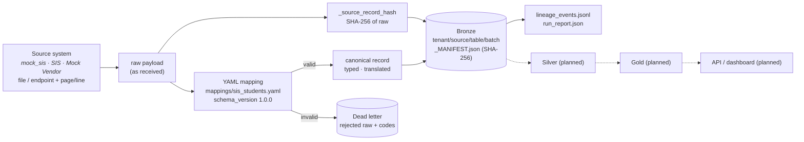

# Data lineage

> **Status (Phase 2):** lineage is captured from **source system → ingestion → Bronze** and is
> verifiable end to end for every record. Silver, Gold and the API are not built yet; their lineage
> is described as the planned extension at the end. All examples come from the Phase 2 evidence run
> on **synthetic** data.

Lineage answers three questions an auditor or a school administrator will ask: *where did this
number come from*, *what was done to it*, and *can you prove the source data was not altered*.

## 1. What is captured, and where



| Level | Captured as | Granularity |
|---|---|---|
| **Run** | `run_report.json`: run id, config path, framework version, start/finish, status, data mode | one run |
| **Job** (source × entity) | `lineage_events.jsonl`: one event per entity batch, inputs → outputs; `run_report.json` entity block | one entity batch |
| **Dataset** | Bronze partition `tenant_id=/source=/table=/batch_id=` + `_MANIFEST.json` (rows, SHA-256 per part, schema version, sensitivity labels) | one batch partition |
| **Record** | Bronze envelope: `_source_name _source_system _source_entity _source_location _source_record_hash _batch_id _run_id _ingestion_ts _schema_version` | one record |
| **Field** | the mapping YAML itself (`source → target`, type, `value_map`, formats) at `_schema_version` | one field |
| **Rejection** | dead-letter entry: location, record hash, coded errors, raw payload | one rejected record |

## 2. Run-level lineage events

For each entity batch the runner emits an **OpenLineage-inspired** event (`job`, `run`, `inputs`,
`outputs`, facets). It borrows the OpenLineage vocabulary so it can be mapped to a lineage service
later; it is **not** claimed to conform to the OpenLineage specification and has not been validated
against a lineage backend. Abridged event for `mock_sis.students`:

```json
{
  "eventType": "COMPLETE",
  "eventTime": "2026-11-22T01:32:12Z",
  "producer": "edupulse-ingestion",
  "run": {"runId": "evidence-run-1", "facets": {"batchId": "evidence-run-1-students"}},
  "job": {"namespace": "edupulse.ingestion", "name": "mock_sis.students"},
  "inputs": [{
    "namespace": "source:SIS/mock_sis", "name": "students",
    "facets": {
      "sourceSystem": {"system": "SIS", "vendor": "Mock Vendor", "product": "Mock SIS", "version": "1.0",
                       "connector_type": "mock_sis", "data_origin": "synthetic"},
      "incremental": {"strategy": "watermark", "since": null, "new_watermark": "2026-01-06T00:00:00Z"},
      "schemaChecks": [{"unit": "mock://mock_sis/students", "ok": true, "fingerprint": "e686760e9830bc91"}],
      "units": [{"unit": "mock://mock_sis/students", "received": 181, "rejected": 2, "status": "read"}]
    }
  }],
  "outputs": [{
    "namespace": "bronze", "name": "sis_students",
    "facets": {
      "schemaVersion": "1.0.0", "recordsLoaded": 179, "status": "SUCCEEDED_WITH_REJECTS",
      "bronzeBatches": ["bronze/tenant_id=tenant-syn-01/source=mock_sis/table=sis_students/batch_id=evidence-run-1-students",
                        "bronze/tenant_id=tenant-syn-02/source=mock_sis/table=sis_students/batch_id=evidence-run-1-students"],
      "deadLetterPath": "dead_letter/source=mock_sis/table=sis_students/batch_id=evidence-run-1-students"
    }
  }]
}
```

A failed entity emits `eventType: "FAIL"` with the same structure, so failed loads are traceable too.

## 3. Worked example: tracing one record

Question: *"A student appears in Bronze table `sis_students`. Where did that row come from?"*
(Synthetic record from the evidence run; the names are fictional.)

1. **Find the record's envelope** in
   `bronze/tenant_id=tenant-syn-01/source=file_drop_synthetic/table=sis_students/batch_id=evidence-run-1-students/part-00000.jsonl`:

   | Envelope field | Value | Meaning |
   |---|---|---|
   | `_source_name` / `_source_system` | `file_drop_synthetic` / `FILE_DROP` | which configured source |
   | `_source_location` | `sis/students.csv:line 2` | exact file and line in the drop folder |
   | `_source_record_hash` | `2301c6a4…d9f6c` | SHA-256 of the raw record |
   | `_batch_id` / `_run_id` | `evidence-run-1-students` / `evidence-run-1` | which load |
   | `_ingestion_ts` | `2026-11-22T01:32:11Z` | when |
   | `_schema_version` | `1.0.0` | which mapping revision |
   | `_data_origin` | `SYNTHETIC_TEST_DATA` | provenance class |

2. **Compare `raw` and `canonical`** in the same row — the *transformation* is the diff, and it is
   fully described by the mapping YAML at that schema version. Example from the mock SIS source of
   the same student:

   | `raw` (as received) | mapping rule | `canonical` |
   |---|---|---|
   | `BirthDate: "04/18/2016"` | `type: date, formats: ["%m/%d/%Y"]` | `birth_date: "2016-04-18"` |
   | `GenderDescriptor: "X"` | `value_map: {X: NON_BINARY}` | `gender: "NON_BINARY"` |
   | `EnglishLearnerFlag: "N"` | `type: boolean` | `english_learner: false` |
   | `LastModifiedDate: "2026-01-01T00:00:00Z"` | `type: datetime` (UTC) | `source_modified_at: "2026-01-01T00:00:00Z"` |
   | `EnrollmentStatus: "Active"` | `case: upper`, `allowed_values` | `enrollment_status: "ACTIVE"` |

3. **Prove the raw payload was not altered**: recompute SHA-256 of `raw` (canonical JSON, sorted
   keys) and compare with `_source_record_hash` (a data-quality test does this for the sampled
   rows of every table), then `edupulse verify-bronze --root data/ingestion` recomputes the
   SHA-256 of each part file against its `_MANIFEST.json`. A modified byte is reported (the
   evidence run demonstrates this: `cli/09_verify_bronze_detects_tampering.txt`).

4. **See the load it belonged to** in `runs/evidence-run-1/run_report.json` (`records`,
   `incremental`, `schema_checks`, retries) and `lineage_events.jsonl` (inputs → outputs).

5. **If a record was rejected instead**, it is not in Bronze; the run report counts it under
   `rejected` with a code and field, and `dead_letter/…/rejected.jsonl` holds the raw payload and
   the same code for correction and replay.

### Reconciliation across sources

The same synthetic students arrive both as a CSV drop (`file_drop_synthetic`) and from the mock
SIS (`mock_sis`/`rest_sis_api`) with different shapes. After mapping, the canonical identity and
demographic fields are identical — asserted by the test
`test_cross_source_reconciliation_file_drop_vs_mock_sis` (240 students, 0 mismatches). That is the
core property of the layer: *different sources, one canonical Bronze view, each row traceable back
to its own source record*.

## 4. Counts as lineage

Every entity reports `received → rejected | accepted → duplicates | unchanged | loaded` and the
invariants hold (`received = rejected + accepted`, `accepted = duplicates + unchanged_skipped +
loaded`). Row counts in Bronze manifests must equal `loaded` summed over the batches of a run;
`evidence/phase-2/evidence.json` records `*_invariants_hold: true` for the three evidence runs.

## 5. Field-level lineage (current and planned)

The mapping YAML is the authoritative **source → Bronze-canonical** field lineage (one line per
target field, versioned by `schema_version`). Silver and Gold will extend the chain with dbt:

| Hop | Mechanism | Status |
|---|---|---|
| source field → Bronze canonical field | mapping YAML + Bronze `raw`/`canonical` | **implemented (Phase 2)** |
| Bronze → Silver | dbt models, `ref()`/`source()` graph, `dbt docs` lineage | planned (no models yet) |
| Silver → Gold metrics | dbt models + exposures | planned |
| Gold → API / dashboard | endpoint ↔ model mapping in API docs | planned |
| Emitting lineage to a catalog (OpenLineage backend, Unity Catalog lineage) | adapter for `lineage_events.jsonl` | planned, not validated |

## 6. Limits

* Lineage is **batch-level for jobs and record-level for data**; there is no column-level lineage
  graph tool yet — the mapping files are read by humans or scripts.
* A "current version" of a record (after updates) is not resolved here; Bronze keeps every version.
* Lineage events are files, not a service; nothing consumes them yet.
* `_source_location` identifies the file/line or endpoint/page of the *delivery*; if a source file
  is later deleted from the drop folder, the hash and Bronze copy remain, but the original file is
  not archived by this phase.
