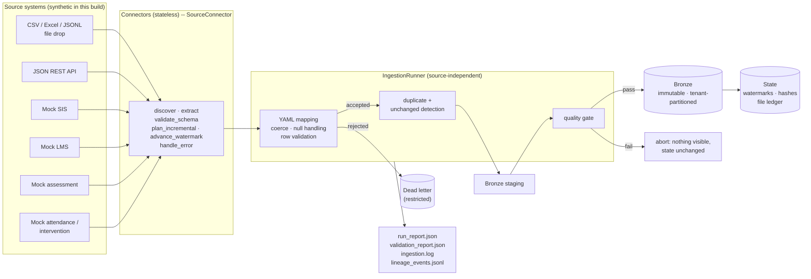

# Multi-source ingestion framework (Phase 2)

> **Status:** implemented and tested against **synthetic data only**. Nothing here has been run
> against a real school system, and no real student data is processed. The framework is
> *configuration-driven*: onboarding a source is YAML (connection + field mapping), not code.
> No FERPA certification or legal-compliance claim is made; the controls are described as
> technical practices consistent with FERPA-aligned handling (see [§13](#13-security-and-privacy-controls)).

Contents: [1 Purpose](#1-purpose-and-scope) · [2 Architecture](#2-architecture) ·
[3 Quick start](#3-quick-start) · [4 Configuration](#4-source-configuration-yaml) ·
[5 Field mapping](#5-field-mapping-yaml) · [6 Connectors](#6-connectors) ·
[7 Pipeline semantics](#7-pipeline-semantics-and-record-accounting) ·
[8 Incremental loading](#8-incremental-loading-and-duplicate-detection) · [9 Bronze](#9-bronze-storage) ·
[10 Errors, retry, dead letter](#10-errors-retry-and-dead-letter) ·
[11 Run report](#11-ingestion-run-report) · [12 Logging](#12-logging) ·
[13 Security](#13-security-and-privacy-controls) · [14 Adding a source](#14-adding-a-new-source) ·
[15 Evidence](#15-evidence-artifacts) · [16 Limits](#16-known-limits)

## 1. Purpose and scope

Different school systems export the same facts in different shapes: a CSV drop from a district, an
Excel workbook from a counselor, a vendor REST API, a student-information system with its own field
names and codes. The ingestion framework turns all of them into **Bronze**: raw, immutable,
tenant-partitioned, fully traceable records plus a typed *canonical* view, with an auditable
account of every record received.

In scope (Phase 2): six connectors, YAML mapping, type coercion, null handling, row-level
validation, duplicate detection, incremental loading, Bronze storage, retry/backoff, dead-letter
handling, a CLI, a JSON run report. **Not** in scope: Silver/Gold transformations, dbt models,
authentication/RBAC/audit-logging of API access, scheduling, encryption at rest (see §16).

## 2. Architecture



Design rules:

* **Connectors only know how to talk to a source.** They are stateless; everything else (mapping,
  validation, dedup, Bronze, dead letter, state, reports) lives in the runner, so every connector
  gets identical guarantees.
* **No school-specific logic in code.** Differences between districts/vendors are expressed as
  YAML: connection settings, `value_map`s, date formats, null tokens.
* **All-or-nothing per entity batch.** Records are written to a staging area and published by an
  atomic rename only after the quality gate passes; state moves in the same step.

## 3. Quick start

```bash
pip install -e ".[dev,excel]"                         # Excel support needs openpyxl

# 1. generate clearly fake (SYNTHETIC_TEST_DATA) source extracts for the file-drop connector
python -m ingestion.synthetic generate --out data/synthetic

# 2. ingest every enabled source into Bronze
edupulse ingest --source all --config ingestion/configs/ingestion.yaml

# one source, or several (comma separated)
edupulse ingest --source mock_sis,mock_lms --config ingestion/configs/ingestion.yaml

# validate and count without writing Bronze/state
edupulse ingest --source all --config ingestion/configs/ingestion.yaml --dry-run

# verify Bronze integrity (SHA-256 per part file + row counts)
edupulse verify-bronze --root data/ingestion
```

`python -m ingestion …` is equivalent to `edupulse …` (useful before installing the script).

| Option | Meaning |
|---|---|
| `--source NAME\|all\|A,B` | which configured sources to run (`all` = every `enabled: true`) |
| `--config PATH` | ingestion YAML (required) |
| `--output-dir DIR` | storage root; default `storage.root` from the config (`data/ingestion`) |
| `--run-id ID` | explicit run id (`[A-Za-z0-9._-]`, ≤ 64); default `run-<UTC timestamp>-<hex>` |
| `--dry-run` | run everything except writing Bronze, dead letter and state |
| `--strict` | exit code 3 if any record was rejected |
| `--override PATH=VALUE` | override a config value (value parsed as YAML), repeatable, e.g. `--override sources.mock_sis.mock.as_of=2026-01-04T00:00:00` |
| `--log-level`, `--quiet` | console verbosity (the JSON log file is always written) |

**Exit codes:** `0` success (incl. rejected records unless `--strict`) · `1` a source/entity failed ·
`2` configuration or usage error · `3` completed with rejects under `--strict`.

Reproducing the *incremental* demo: run once with `--override …mock.as_of=2026-01-06T00:00:00` for
each mock source, then again with `…as_of=2026-01-20T00:00:00`; the second run loads only new and
updated records. `evidence/phase2.py` does exactly this (§15).

## 4. Source configuration (YAML)

One file defines storage, defaults and any number of named sources
(`ingestion/configs/ingestion.yaml` is the annotated reference). Unknown keys are **rejected**
(`extra="forbid"`), so typos fail loudly. YAML is parsed with `yaml.safe_load` only.

```yaml
version: 1
storage: {root: data/ingestion}
defaults:
  retry: {max_attempts: 4, base_delay_seconds: 0.5, max_delay_seconds: 30, multiplier: 2.0, jitter: true}
  quality_gate: {max_reject_ratio: 0.10, min_records: 10}

sources:
  mock_sis:                              # <- the NAME used with --source
    type: mock_sis                       # selects the connector
    system: {system: SIS, vendor: Mock Vendor, product: Mock SIS, version: "1.0"}   # source-system metadata
    data_origin: synthetic               # only 'synthetic' is enabled in this build
    retry: {max_attempts: 3}             # optional per-source override
    quality_gate: {max_reject_ratio: 0.05}
    entities:
      - {name: students, mapping: mappings/sis_students.yaml}
```

Common source keys: `type`, `system{system,vendor,product,version,description}`, `tenant_id`
(optional, for sources that do not carry a tenant column), `data_origin`, `enabled`, `retry`,
`quality_gate`, `entities`. Entity keys: `name`, `mapping` (path relative to the config file),
`enabled`, `stream_error_policy` (`fail_entity` | `skip_stream`). Connector-specific keys are in §6.
`drop_dir` and `storage.root` are relative to the **current working directory**.

Secrets are never written in config: REST authentication names an **environment variable**
(`auth: {type: bearer, token_env: SIS_API_TOKEN}`); a literal `token:` key is rejected by the schema.

## 5. Field mapping (YAML)

One mapping file per entity (`ingestion/configs/mappings/`). It declares how **source** fields
become **canonical** fields, with types, null handling, code translation, constraints and
sensitivity labels. Excerpt of `sis_students.yaml`:

```yaml
entity: students
bronze_table: sis_students
schema_version: "1.0.0"                 # recorded on every Bronze record and in the manifest
primary_key: [tenant_id, student_id]    # used for duplicate-key detection
incremental_field: source_modified_at   # canonical datetime that drives the watermark
unknown_fields: warn                    # warn | ignore | reject_entity
duplicate_policy: keep_first            # keep_first | reject
fields:
  - {source: DistrictId, target: tenant_id, required: true}
  - {source: StudentUniqueId, target: student_id, required: true, sensitivity: confidential}
  - {source: FirstName, target: first_name, required: true, sensitivity: restricted}
  - {source: BirthDate, target: birth_date, type: date, formats: ["%m/%d/%Y"], required: true, sensitivity: restricted}
  - {source: GenderDescriptor, target: gender, required: true, value_map: {F: FEMALE, M: MALE, X: NON_BINARY}}
  - {source: EnglishLearnerFlag, target: english_learner, type: boolean, required: true}
  - {source: LastModifiedDate, target: source_modified_at, type: datetime, required: true}
```

**Field options:** `source` (name, or list of aliases — first non-null wins) · `constant` ·
`from_config: tenant_id` (exactly one of the three) · `type` (`string integer float boolean date
datetime`) · `required` · `default` · `null_values` · `trim` · `case` (`upper|lower`) · `formats`
(strptime) · `true_values`/`false_values` · `allowed_values` · `value_map` · `pattern` · `min`/`max`
· `max_length` · `sensitivity` (`public internal confidential restricted`).

**Rules enforced when the mapping loads:** a `tenant_id` field is mandatory (multi-tenant
isolation, ADR-0002); target names are unique; `primary_key` fields must exist;
`incremental_field` must be a `datetime` field; invalid regexes and unknown keys are errors; a
synthetic source must map a `synthetic_marker` field.

**Coercion.** `integer` accepts `"42"`, `" 7 "`, `5.0`, `"5.0"` but rejects `"3.7"`, `True`,
`"1e999"`; `float` rejects `NaN`/`inf`; `boolean` accepts `true/t/yes/y/1` and `false/f/no/n/0`
(case-insensitive, overridable); `date` normalizes to `YYYY-MM-DD`; `datetime` normalizes to UTC
`YYYY-MM-DDTHH:MM:SSZ` (offsets are converted; naive values are **assumed UTC**).

**Null handling.** After trimming, the tokens `""`, `NULL`, `N/A`, `NA`, `-` (case-insensitive;
overridable per mapping/field) and `None` are *null*. A null optional field becomes `null`; a null
`required` field is a `MISSING_REQUIRED` rejection; a `default` replaces the null and is coerced
like any value. A source column that is absent entirely is treated as null for optional fields.

**Row-level validation errors.** Each rejected record gets one or more coded errors — they never
contain the offending value:

| Code | Meaning |
|---|---|
| `MISSING_REQUIRED` | required field is null/absent |
| `TYPE_COERCION_FAILED` | value cannot become the declared type |
| `OUT_OF_RANGE` | below `min` / above `max` |
| `NOT_IN_ALLOWED_VALUES` | not in `allowed_values` |
| `NOT_IN_VALUE_MAP` | code has no entry in `value_map` |
| `PATTERN_MISMATCH` · `MAX_LENGTH_EXCEEDED` | pattern / length constraint |
| `COLUMN_COUNT_MISMATCH` | CSV row has a different column count than the header |
| `INVALID_JSON` · `ROW_NOT_AN_OBJECT` | JSON Lines / JSON record cannot be parsed or is not an object |
| `DUPLICATE_KEY` | same primary key, different content, with `duplicate_policy: reject` |
| `SYNTHETIC_MARKER_INVALID` | synthetic source record lacks the `SYNTHETIC_TEST_DATA` marker |

Order matters in a field: `trim` → `case` → `value_map` → coercion → constraints. For example, after
`case: upper`, `value_map` keys must be upper-case (a real bug caught by the quality gate while
building the assessment mapping).

## 6. Connectors

All connectors implement the abstract `SourceConnector` (`ingestion/connectors/base.py`):

| Method | Responsibility |
|---|---|
| `discover()` | list the configured entities the source can currently provide (file drops also report how many files match) |
| `extract(entity, since)` | lazily yield `RecordStream` units (one file, or one API endpoint) of `RawRecord`s; transient I/O goes through the retry helper |
| `validate_schema(entity, mapping, observed_fields)` | compare observed fields with the mapping: missing required, missing optional, unexpected, fingerprint |
| `plan_incremental(entity, mapping, last_watermark)` + `advance_watermark(...)` | choose `watermark` / `file_ledger` / `full_refresh`; compute the monotonic new watermark |
| `handle_error(error, context)` | classify a failure into `retry`, `skip_stream`, `fail_entity` or `abort_source` |

Each connector exposes source-system metadata (`metadata`: source name, system, connector type,
data origin, extraction method, vendor/product/version) that is stored in reports and lineage.

| `type:` | Class | Reads | Connector-specific YAML |
|---|---|---|---|
| `file_drop` | `FileDropConnector` | CSV, Excel (`.xlsx`), JSON Lines, JSON array files in a drop directory | `drop_dir`, `max_file_mb`; per entity `file_pattern` (glob, confined to `drop_dir`), `format` (`csv excel jsonl json auto`), `csv{delimiter,encoding,quotechar}`, `excel{sheet,header_row}`, `json_records_path` |
| `rest_api` | `RestApiConnector` | JSON over HTTP(S) | `base_url`, `auth{type,token_env,header_name}`, `timeout_seconds`, `allow_insecure_http`, `allowed_hosts`, `max_pages`, `max_response_mb`; per entity `path`, `records_path`, `since_param`, `query`, `pagination{type: none\|page\|cursor, …}` |
| `mock_sis` | `MockSISConnector` | Ed-Fi-style names, `MM/DD/YYYY` dates, `Y/N` flags, one-letter gender codes — schools, students | `mock{seed,tenants,schools_per_tenant,students_per_school,page_size,as_of,faults}` |
| `mock_lms` | `MockLMSConnector` | `TenantKey/LearnerId` names, nullable assignment ref — lms_activity | same `mock` block |
| `mock_assessment` | `MockAssessmentConnector` | `C/NC/EX` status codes, `"N/A"` scores, title-case bands — assessment definitions & results | same |
| `mock_attendance_intervention` | `MockAttendanceInterventionConnector` | `YYYYMMDD` dates, `P/AE/AU/T` codes, numeric tiers — daily attendance & interventions | same |

**File drop.** Header and row handling for CSV uses `csv.reader` (so quoted newlines work); a UTF-8
BOM is tolerated; ragged rows are *rejected*, not padded. Excel is read with `openpyxl` in
read-only/`data_only` mode (cached formula values; dates become ISO strings) and needs the
`excel` extra — without it the error says exactly what to install. Patterns containing `..` or an
absolute path are refused, symlinks that resolve outside `drop_dir` are ignored, and files over
`max_file_mb` fail the entity. A locked file (`PermissionError`, typical when Excel has it open) is
retried as a transient failure.

**REST API.** Standard-library `urllib`. `https` is required unless the host is loopback or
`allow_insecure_http: true`; `allowed_hosts` can pin the host; credentials embedded in the URL are
refused; **redirects are refused** (they could carry credentials to another host); responses are
capped by `max_response_mb`; paging stops at an empty page or `max_pages`. HTTP 408/425/429/500/
502/503/504, timeouts and connection errors are *transient* (honoring `Retry-After`); 401/403 abort
the whole source (every other entity would fail the same way and retrying risks lockouts); other
4xx are permanent. Page pagination deliberately reads until an *empty* page, which stays correct
when a server silently caps the page size. URLs are never logged with query strings or secrets.

**Mock systems.** They simulate what a vendor integration looks like — native names/formats,
pagination, a modification timestamp, transient failures — on top of the synthetic dataset, so the
whole path can be tested with no real system. They are deterministic: `as_of` is the source
system's "now" (records modified later are invisible); about 4 % of mutable records get an updated
version three days after creation. **Fault injection** (`mock.faults`): `fail_first_n_calls`
(transient failures), `bad_row_rate` (rows that must be rejected: bad date, unknown code, blank
ID), `duplicate_row_rate`, `drop_fields` / `add_fields` (schema drift).

## 7. Pipeline semantics and record accounting

For every enabled entity of a selected source the runner does:

1. plan incremental load (watermark / file ledger) · 2. extract streams ·
3. skip file units already ingested (path + SHA-256) · 4. sample the first 50 records of
API-style sources, check the observed schema against the mapping, compare with the last run's
fingerprint (drift warning) · 5. per record: parse error → map & coerce → validate →
synthetic-marker check · 6. duplicate / unchanged detection · 7. write accepted new records to Bronze
staging, rejected records to the dead letter · 8. quality gate · 9. atomic Bronze commit, then state
commit · 10. report + lineage event.

**Counters** (per entity, rolled up per source and run):

| Counter | Definition |
|---|---|
| `received` | records the connector delivered (including unparseable ones) |
| `rejected` | failed parsing or validation → dead letter |
| `accepted` | `received − rejected` |
| `transformed` | accepted records successfully mapped and type-coerced (**equals `accepted`**) |
| `duplicates` | accepted but identical to (or same key as) an earlier record **in this batch** |
| `unchanged_skipped` | accepted but already in Bronze from an earlier run (same content hash) |
| `loaded` | **new** records written to Bronze in this run |
| `retries` | transient failures retried while extracting |

Invariants (asserted by tests for every successful entity, and re-checked on the evidence runs):

```
received    = rejected + accepted
accepted    = duplicates + unchanged_skipped + loaded
transformed = accepted
```

For a *failed* entity (`FAILED`, `FAILED_QUALITY_GATE`) `loaded` is reset to `0` and the invariants
do not apply: nothing was written.

**Statuses.** Entity: `SUCCEEDED`, `SUCCEEDED_WITH_REJECTS`, `NO_NEW_DATA` (nothing new; includes
"only unchanged records came back"), `FAILED`, `FAILED_QUALITY_GATE`. Source/run: worst-wins roll-up
(`COMPLETED_WITH_REJECTS`, `PARTIAL_FAILURE`, `FAILED`, …).

**Quality gate.** Once at least `min_records` (default 10) were received, if
`rejected / received > max_reject_ratio` (default 10 %), the entity fails: Bronze staging is
discarded, state does not move, the dead letter is kept for diagnosis. This protects Bronze from a
systematically broken feed (it caught a genuine mapping mistake during development).

## 8. Incremental loading and duplicate detection

* **Watermark sources** (REST with `since_param`, mocks): the stored watermark is the maximum
  canonical `incremental_field` seen in the last *successful* load; it never moves backwards. It is
  sent as an **inclusive** lower bound (`>=`), so a record changed exactly at the boundary is never
  missed; the boundary record comes back again and is suppressed by hash idempotency (visible as
  `unchanged_skipped: 1` in later runs).
* **File-drop sources:** a ledger of `(path, SHA-256)` skips files already ingested. A file
  re-delivered with the same name but changed content is re-read; only changed rows are loaded.
* **Idempotency:** every raw record has a `_source_record_hash` (SHA-256 of the raw payload as
  canonical JSON: sorted keys, no whitespace, never including ingestion metadata). A record whose
  hash is already known is not loaded again. Re-running the same ingestion is therefore a no-op.
* **Updates are new versions, never overwrites:** when the source changes a record, the new
  content has a new hash and lands as a new Bronze row; the earlier version stays (history).
  Choosing the "current" version is a Silver-layer concern.
* **Duplicate detection** is three-fold: identical content within a batch (`duplicates`, warning
  `DUPLICATE_RECORD_IN_BATCH`); same primary key but different content within a batch (keep the
  first and warn, or reject, per `duplicate_policy`); identical content already loaded in an earlier
  run (`unchanged_skipped`).
* **State** (`<root>/_state/ingest_state.sqlite`: `watermarks`, `loaded_hashes`, `processed_units`,
  `committed_batches`, `schema_fingerprints`) is committed in one transaction *after* the Bronze
  commit. It is a rebuildable cache of what Bronze contains — Bronze is the source of truth.
  **Recovery:** at the start of every entity load the runner compares the Bronze batches of that
  source/table with `committed_batches`; any batch state does not know (a crash between the Bronze
  and state commits, or a deleted state file) is re-registered from Bronze — its record hashes and
  maximum watermark — and logged as `state_recovered`. Tests simulate both cases and assert that
  nothing is loaded twice. A *dry run* works on an in-memory copy of the state and never writes it.
  The file ledger (path + checksum) is not recoverable from Bronze; after state loss, files are
  re-read and their rows are suppressed as `unchanged_skipped`. State is **not** safe for two
  concurrent runners (see §16).

## 9. Bronze storage

```
<root>/bronze/tenant_id=<tenant>/source=<source>/table=<bronze_table>/batch_id=<batch>/
    part-00000.jsonl      one JSON object per record
    _MANIFEST.json        rows, SHA-256 per part, schema_version, source, sensitivity labels
```

Every record carries the envelope fields required by the spec, plus the data:

| Field | Content |
|---|---|
| `_source_name`, `_source_system`, `_source_entity` | which configured source / system / entity |
| `_ingestion_ts` | UTC time the entity batch started |
| `_batch_id`, `_run_id` | `<run_id>-<entity>` and the run |
| `_source_record_hash` | SHA-256 of the raw payload |
| `_schema_version` | from the mapping file (`1.0.0`) |
| `_source_location` | file + line, or endpoint + page/index |
| `_bronze_table`, `_data_origin` | target table; `SYNTHETIC_TEST_DATA` |
| `tenant_id` | partition key (ADR-0002) |
| `raw` | the record **as received** (strings stay strings) |
| `canonical` | typed, translated record per the mapping |

**Immutability and integrity:** a batch directory is created once by an atomic `os.replace` from a
staging area — publishing over an existing batch raises `ImmutabilityError`; committed files are
read-only; `_MANIFEST.json` stores SHA-256 and row counts; `edupulse verify-bronze` recomputes them
and reports modified, missing, extra or truncated files. A mixed-tenant extract is split by
`tenant_id` at write time, so a partition never holds another tenant's rows. Partition values are
percent-encoded, so hostile source values (`../`) cannot escape the Bronze root. These are
*tamper-evidence* and *accidental-overwrite* controls; they are not a substitute for storage-level
object lock / access control, which the deployment must provide.

## 10. Errors, retry and dead letter

| Class | Examples | Behavior |
|---|---|---|
| Transient | HTTP 429/5xx, timeouts, connection refused, locked file | retried with backoff; counted in `retries`; after `max_attempts` → `RetryExhaustedError` (permanent) → entity `FAILED` |
| Permanent | HTTP 404, malformed payload, missing file, oversize file | not retried; entity `FAILED` |
| Authentication | HTTP 401/403 | not retried; **aborts the source** (remaining entities not attempted) |
| Schema | required source field missing, non-JSON body | entity `FAILED`, or the file is skipped with a warning under `stream_error_policy: skip_stream` |
| Row-level | see §5 codes | record rejected → dead letter; the run continues |

**Retry/backoff.** Exponential: `base × multiplier^(attempt−1)`, capped at `max_delay`, with *full
jitter* (uniform in `[0, ceiling]`) to avoid synchronized retries. A `Retry-After` header raises the
floor but never above `max_delay`. Sleep and randomness are injectable, so tests run instantly and
deterministically.

**Dead letter** (`<root>/dead_letter/source=…/table=…/batch_id=…/rejected.jsonl` + manifest): the
raw payload, location, record hash and the **value-free** list of row errors, so the source can be
corrected and the records replayed. Because it contains raw values it is **restricted data**: written
owner-read-only where the OS allows, never printed in logs, never copied into reports. A replay
command is not implemented in this phase (§16).

## 11. Ingestion run report

Every run writes, under `<root>/runs/<run_id>/`:

| File | Content |
|---|---|
| `run_report.json` | the report below |
| `validation_report.json` | per entity: schema checks, error counts by code and field, value-free examples (location + code + field) |
| `ingestion.log` | structured JSON lines (§12) |
| `lineage_events.jsonl` | one lineage event per entity (see [data-lineage.md](data-lineage.md)) |
| `summary.txt`, `summary.md` | the same counts as a fixed-width table / Markdown table by source |

Report skeleton (`report_schema_version: "1.0"`; abridged from the Phase 2 evidence run):

```json
{
  "run_id": "evidence-run-1", "status": "COMPLETED_WITH_REJECTS", "dry_run": false,
  "data_mode": "synthetic", "framework_version": "0.2.0",
  "started_at": "…Z", "finished_at": "…Z", "duration_seconds": 1.19,
  "records": {"received": 13403, "accepted": 13372, "rejected": 31, "duplicates": 42,
              "unchanged_skipped": 0, "transformed": 13372, "loaded": 13330, "retries": 1},
  "sources": [{
    "source": "mock_sis", "connector_type": "mock_sis", "status": "COMPLETED_WITH_REJECTS",
    "source_system": {"system": "SIS", "vendor": "Mock Vendor", "data_origin": "synthetic", "…": "…"},
    "duration_seconds": 0.14, "records": {"received": 185, "…": "…"},
    "entities": [{
      "entity": "students", "bronze_table": "sis_students", "status": "SUCCEEDED_WITH_REJECTS",
      "batch_id": "evidence-run-1-students", "schema_version": "1.0.0", "duration_seconds": 0.04,
      "records": {"received": 181, "accepted": 179, "rejected": 2, "transformed": 179, "loaded": 179, "…": "…"},
      "incremental": {"strategy": "watermark", "since": null, "new_watermark": "2026-01-06T00:00:00Z"},
      "schema_checks": [{"unit": "mock://mock_sis/students", "ok": true, "fingerprint": "e686…", "unexpected": []}],
      "validation": {"errors_by_code": {"NOT_IN_VALUE_MAP": 1, "TYPE_COERCION_FAILED": 1},
                     "errors_by_field": {"birth_date": 1, "gender": 1}},
      "bronze_batches": ["bronze/tenant_id=tenant-syn-01/source=mock_sis/…"],
      "dead_letter_path": "dead_letter/source=mock_sis/table=sis_students/batch_id=…"
    }]
  }]
}
```

A complete sample, by source, is in `evidence/phase-2/sample_run_by_source.md` (three runs: first
load, incremental, no-change) with the underlying `run_report.json` files next to it.

## 12. Logging

`ingestion.log` is JSON Lines: `ts`, `level`, `event` (`run_started`, `source_started`,
`entity_started`, `unit_skipped`, `entity_finished`, `source_finished`, `run_finished`, …) plus
counters, ids and statuses. `log_event` accepts only primitive values and truncates long strings, so
record objects cannot be logged by construction; row *values* are never passed in. The console gets a
short human-readable form on stderr. Tests scan every report/log file for real student names and IDs
from the loaded data and fail on any hit.

## 13. Security and privacy controls

These are **technical controls consistent with FERPA-aligned practices**; they are not a
certification and do not by themselves make a deployment compliant.

| Control | Implemented in Phase 2 |
|---|---|
| No real PII | synthetic-only; `data_origin: production` is refused; synthetic sources must carry and validate the `SYNTHETIC_TEST_DATA` marker on every record |
| PII minimization in telemetry | reports, logs, lineage and validation errors contain counts, codes, field names and identifiers — never values (tested) |
| Field sensitivity labels | `public/internal/confidential/restricted` per field, stored in each Bronze manifest for later masking/RBAC |
| Secret hygiene | credentials only via environment-variable *names*; secrets not logged; embedded URL credentials refused; schema rejects literal secrets |
| Transport | https required for remote REST hosts; no redirects; optional host allow-list; response size and page caps |
| Input hardening | `yaml.safe_load`; path confinement and symlink-escape protection for file drops; size limits; percent-encoded partition values |
| Tenant isolation | `tenant_id` mandatory in every mapping, a Bronze partition key, split at write time |
| Tamper evidence | write-once batches, read-only files, SHA-256 manifests, `verify-bronze` |
| Restricted dead letter | owner-read-only files; excluded from reports and logs |
| **Not implemented yet** | encryption at rest, access control/RBAC and audit logging for reading Bronze, retention/deletion jobs, masking (all later phases) |

## 14. Adding a new source

1. Write a mapping YAML for each entity (copy the closest file in `ingestion/configs/mappings/`).
2. Add a source block in the ingestion YAML: `type`, `system` metadata, connector settings, entities.
3. `edupulse ingest --source <name> --config <path> --dry-run` and read the validation report; tune
   `formats`, `value_map`, `null_values` until rejects are only genuinely bad rows.
4. Run for real; check `verify-bronze` and the run report.

A genuinely new *kind* of system (say SFTP or a database) is a new `SourceConnector` subclass
registered in `ingestion/connectors/__init__.py` (the runner, mapping, Bronze and reports need no
change) plus a config model in `ingestion/config.py`. No district- or vendor-specific code belongs
in the repository.

## 15. Evidence artifacts

Generated by `python evidence/collect_evidence.py --phase 2` (`make evidence-phase2`), which runs
the **real CLI** in a scratch directory — nothing is hand-written. Output: `evidence/phase-2/`.

| Evidence | Where |
|---|---|
| Ingestion logs | `run-{1-first-load,2-incremental,3-no-change}/ingestion.log` |
| Run reports (JSON) + summaries by source | `run-*/run_report.json`, `run-*/summary.md`, `sample_run_by_source.md` |
| Validation reports | `run-*/validation_report.json` |
| CLI output (generate, 3 ingests, dry run, 2 error cases, verify, tamper detection, help) | `cli/01…10_*.txt` |
| Test coverage report | `coverage/coverage_report.{txt,json}` |
| Test results | `evidence.json` (`tests`), `junit-all.xml` |
| Lineage events | `run-*/lineage_events.jsonl` |
| Samples (synthetic) | `samples/` (Bronze manifest + 2 rows, dead-letter manifest + 3 rows) |
| Machine-readable roll-up | `evidence.json` (`ingestion`, `coverage`, `checks`) |

## 16. Known limits

* **Coverage tool.** `coverage.py` could not be installed in the build environment, so the committed
  report comes from `evidence/line_coverage.py` (stdlib `sys.monitoring`): **line coverage only**, no
  branch coverage, subprocess code (the CLI subprocess tests) not measured. Authoritative CI
  measurement is `pytest --cov` (`make coverage`).
* **Not run on real systems.** Only synthetic data, an in-process mock REST API on loopback and mock
  vendor connectors. TLS behavior, real vendor pagination/rate limits, and large volumes
  (the evidence runs ≈ 13 k records; dedup keeps hashes in memory per batch) are untested.
* **Single runner.** The SQLite state store assumes one runner at a time; no locking across
  concurrent runs. Scheduling/orchestration is not part of this phase.
* **No replay tool** for dead-letter records yet; no automatic schema evolution (a changed schema
  raises a drift warning or fails the entity).
* **Watermark granularity.** Timestamps are compared as UTC ISO strings with second resolution;
  sources that update records without changing their modified timestamp cannot be detected
  incrementally (use a periodic full refresh — hash idempotency makes it safe).
* **Excel**: only `.xlsx` through `openpyxl`; formulas are read as cached values; macros are ignored.
* **CI** has not run on GitHub (repository not pushed).
